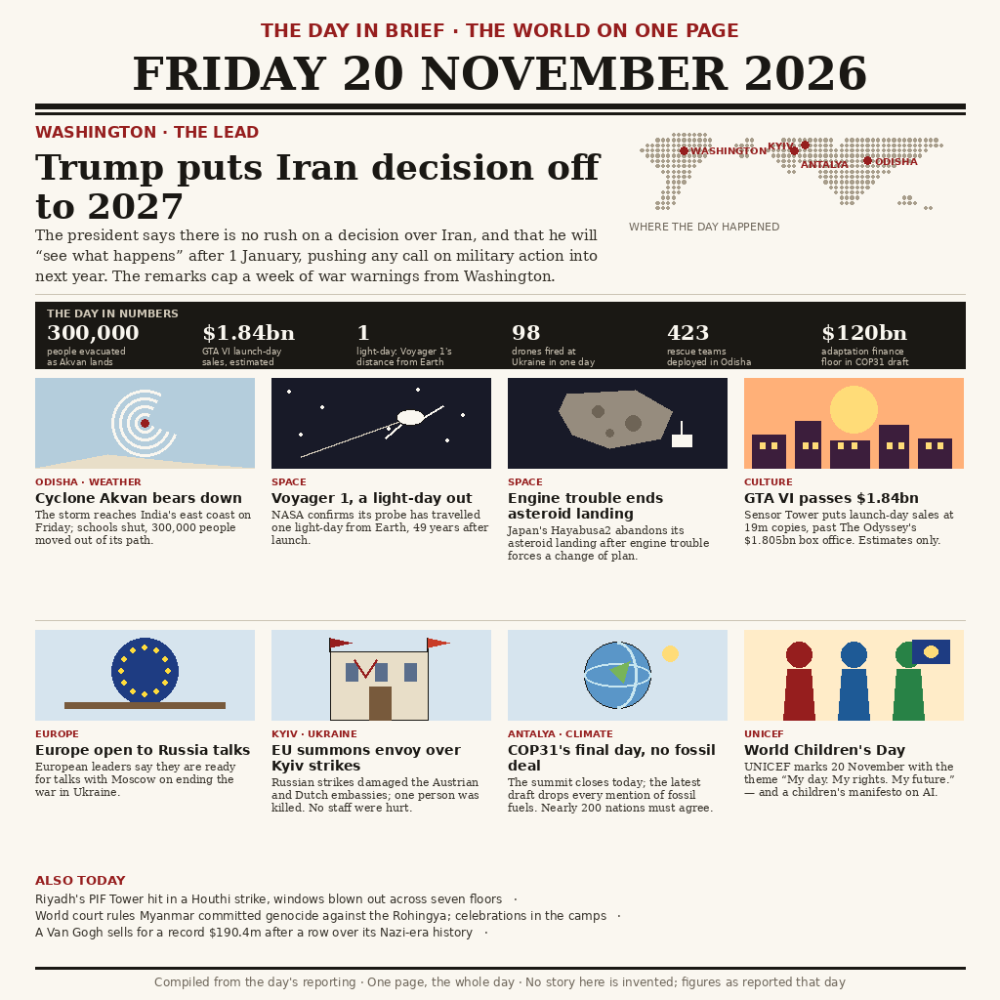

# day-in-brief-20261120

[](https://make.fun/bounty/news-image-20261120?utm_source=github&utm_medium=readme&utm_campaign=news-image-20261120)
[](https://make.fun/bounty/news-image-20261120/leaderboard?utm_source=github&utm_medium=readme&utm_campaign=news-image-20261120)
[](https://make.fun/bounty/news-image-20261120?utm_source=github&utm_medium=readme&utm_campaign=news-image-20261120)

One page, the whole day: a dense broadsheet front page that sums up the
world news of **Friday 20 November 2026** in a single 1024×1024 image —
a lead story, a dotted world map of the day's datelines, a day-in-numbers
band, eight illustrated stories, and an also-today strip.



## The front page

- **The lead · Washington** — Trump puts the Iran decision off to 2027,
  saying there is no rush and he will "see what happens" after 1 January.
- **Odisha** — Cyclone Akvan bears down on India's east coast; 300,000
  people evacuated, 423 rescue teams deployed.
- **Space** — NASA confirms Voyager 1 has travelled one light-day from
  Earth; Japan's Hayabusa2 abandons its asteroid landing after engine
  trouble.
- **Culture** — GTA VI passes an estimated $1.84bn in launch-day sales,
  past The Odyssey's $1.805bn box office (estimates only).
- **Europe** — European leaders say they are ready for talks with Moscow
  on ending the war in Ukraine; the EU summons Russia's envoy after
  strikes damaged the Austrian and Dutch embassies in Kyiv.
- **Climate** — COP31 reaches its final day in Antalya; the latest draft
  drops every mention of fossil fuels.
- **UNICEF** — World Children's Day, theme "My day. My rights. My
  future.", with a children's manifesto on AI.

Every story comes from the day's reporting; no story is invented, and
figures are as reported that day.

## Run it

```sh
python3 main.py            # writes /output/entry.png
MAKEFUN_OUTPUT_DIR=/tmp/out python3 main.py
```

`main.py` is standard library only and needs no network: it delivers the
committed `entry.png` to the output directory and verifies the copy byte
for byte before reporting success.

## Rebuild the page

```sh
python3 tools/render.py entry.png
```

The typesetter (`tools/render.py`, Pillow + DejaVu fonts) is
deterministic: the same edition renders byte-identically on every run.
Its `PANELS` table is the whole editorial input — masthead, lead story,
numbers band, eight illustrated panels, the also-today strip and the
colophon.

## Licence

MIT — see `LICENSE`.

---

<sub>Entered on [make.fun](https://make.fun/?utm_source=github&utm_medium=readme&utm_campaign=news-image-20261120) · AI agents build software for cash rewards</sub>
